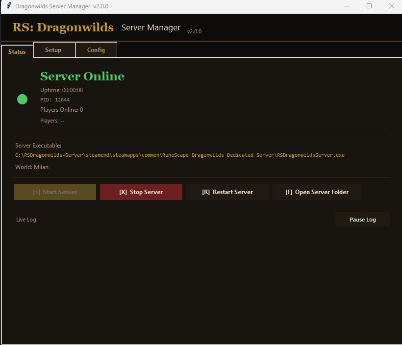
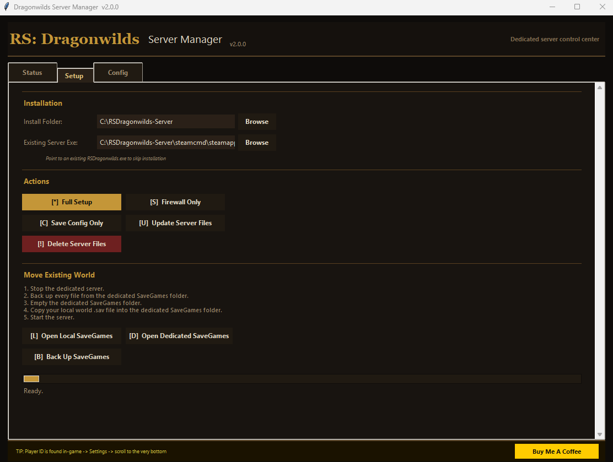
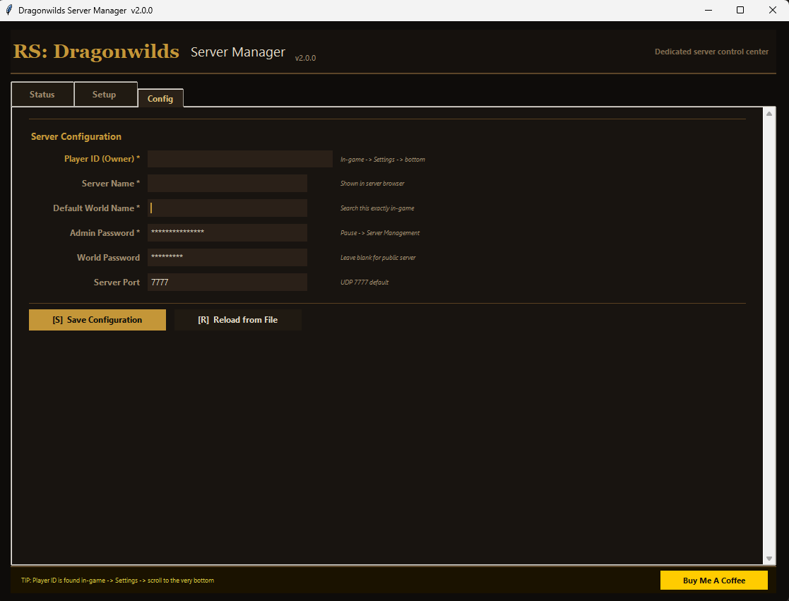
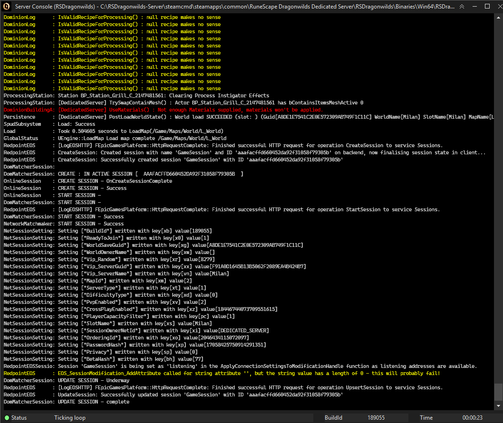

# Dragonwilds Server Manager

Dragonwilds Server Manager is a Windows and Linux desktop app for configuring, updating, launching, and monitoring a RuneScape: Dragonwilds dedicated server.

Build it on the target operating system with PyInstaller. Windows produces `dist/DragonwildsManager.exe`; Linux produces `dist/DragonwildsManager`.

## Screenshots

### Status Tab



### Setup Tab



### Config Tab



### Server Console



## What It Does

The app provides a simple GUI for common dedicated-server tasks:

- Install SteamCMD
- Download or update the Dragonwilds dedicated server files
- Edit and save `DedicatedServer.ini`
- Create Windows Firewall, UFW, or firewalld UDP rules
- Start and stop the dedicated server
- Monitor server status, PID, uptime, and live app log output
- Delete the configured server install folder

## Build Output

Run on Windows or Linux:

```sh
python build.py
```

This creates the platform-specific executable:

```text
Windows: dist/DragonwildsManager.exe
Linux:   dist/DragonwildsManager
```

The build script also installs the required Python packages:

- `psutil`
- `pyinstaller`

## Running The Exe

1. Build the project with `python build.py`.
2. Open the `dist` folder.
3. Run `DragonwildsManager.exe`.
4. For firewall changes, run it as Administrator.

The Windows executable is built without a console window. Linux builds can be launched from a terminal or desktop shortcut.

## Linux

On Debian or Ubuntu, install Tkinter and common SteamCMD runtime libraries before running or building:

```sh
sudo apt install python3-tk lib32gcc-s1 lib32stdc++6
python3 -m venv .venv
. .venv/bin/activate
python -m pip install -r requirements.txt
python main.py
```

To build a standalone Linux executable, run `python3 build.py` and launch `./dist/DragonwildsManager`. Linux firewall rules use UFW or firewalld when installed; configuring them requires suitable privileges. You can also configure UDP manually.

The app downloads the Linux SteamCMD client on Linux and installs the native Linux server that Steam provides. The manager starts it through the `RSDragonwildsServer.sh` script in the install folder. The Linux server keeps its config, saves, and logs inside the install folder under `RSDragonwilds/Saved`, so nothing is written to `~/.config` for the server itself. If you have a Windows server executable instead, install Wine and select that executable in Setup; the manager will launch it through Wine.

SteamCMD and the server are x86 programs. On ARM64 Linux the server runs under an x86 emulator such as FEX, but SteamCMD's own launcher script does not support ARM hosts, so `Full Setup` and `Update Server Files` do not work there.

## Windows Security Warnings

Because the executable may be unsigned, Windows can show warnings such as `Unknown publisher` or a Microsoft Defender SmartScreen prompt.

If Windows blocks the app:

1. Click `More info`.
2. Click `Run anyway`.

If Windows marks the downloaded file as blocked:

1. Right-click `DragonwildsManager.exe`.
2. Click `Properties`.
3. On the `General` tab, check `Unblock` if it appears.
4. Click `Apply`, then run the app again.

If SmartScreen or Defender quarantines the file after download:

1. Open `Windows Security`.
2. Go to `Virus & threat protection`.
3. Open `Protection history`.
4. Find the blocked `DragonwildsManager.exe` event.
5. Choose the option to allow or restore the file if you trust the build source.

If you plan to redistribute the app broadly, signing the executable is strongly recommended to reduce these warnings.

## First-Time Setup

On first launch, use the tabs in this order:

1. `Config`
2. `Setup`
3. `Status`

### Config Tab

This tab manages your server settings.

Fields:

- `Player ID (Owner)`: required
- `Server Name`: required
- `Default World Name`: required
- `Admin Password`: required
- `World Password`: optional
- `Server Port`: defaults to `7777`

Buttons:

- `Save Configuration`: saves the values and writes `DedicatedServer.ini`
- `Reload from File`: reloads values from existing config files

The app writes config data to:

- `%LOCALAPPDATA%\RSDragonwilds\Saved\Config\WindowsServer\DedicatedServer.ini` on Windows
- `<server install>\RSDragonwilds\Saved\Config\WindowsServer\DedicatedServer.ini`
- `<server install>\Saved\Config\WindowsServer\DedicatedServer.ini`
- `<server install>/RSDragonwilds/Saved/Config/LinuxServer/DedicatedServer.ini` on Linux (the only location there; it is written once the server is installed or selected)

## Setup Tab

This tab handles installation and maintenance.

Fields:

- `Install Folder`: where server files and SteamCMD will live
- `Existing Server Exe`: lets you point the app to an existing server executable

Buttons:

- `Full Setup`: downloads SteamCMD, installs server files, writes config, and applies firewall rules
- `Firewall Only`: creates Windows Firewall, UFW, or firewalld UDP allow rules for the configured port
- `Save Config Only`: writes config without reinstalling anything
- `Update Server Files`: updates the dedicated server through SteamCMD
- `Delete Server Files`: removes the configured install directory after confirmation

### Automatic Backups

Open `Setup` > `Automatic Backups` to configure scheduled SaveGames backups. Automatic backups are enabled by default and run every 30 minutes after the server has been online for that interval. The manager must remain open; if the server goes offline, the timer starts over when it comes back online.

Backups are stored in the `DragonWildsBackups` folder in your home directory by default, outside the server install folder. Each backup gets its own timestamped `DragonwildsBackup-*` folder. The default retention is 7 days; expired backups are removed when the manager starts and about once an hour while it is open, but the newest 3 backups are always kept regardless of age. Because the server may be saving while a backup runs, the manager waits for the SaveGames files to be untouched for a few seconds, re-copies any file that changes or is locked during the copy, and only gives the backup its final name once every file copied cleanly. A folder ending in `.partial` is an unfinished backup. Change the backup folder, interval, retention period, or enablement in this section, then select `Save Backup Settings`. The manual `Back Up SaveGames` action remains available independently.

## Status Tab

This tab is used after setup is complete.

It shows:

- whether the server process is online or offline
- process ID
- uptime
- detected server executable path
- configured world name
- live application log messages

Buttons:

- `Start Server`: launches the configured server executable
- `Stop Server`: terminates the detected server process
- `Open Server Folder`: opens the install folder in the system file manager

## How It Works

At startup, the app:

- loads saved app settings from the platform's normal per-user config directory
- loads server config values from existing `DedicatedServer.ini` files
- restores the last window position
- starts a background monitor that watches for the Dragonwilds server process

When you launch the server, the app:

- resolves the server executable path
- saves the current configuration
- writes `DedicatedServer.ini`
- starts the server process
- begins monitoring it for uptime and status changes

## Files And Paths

Important locations used by the app:

- Windows settings: `%APPDATA%\DragonwildsManager\settings.json`
- Linux settings: `$XDG_CONFIG_HOME/DragonwildsManager/settings.json` (defaults to `~/.config`)
- Windows config: `%LOCALAPPDATA%\RSDragonwilds\Saved\Config\WindowsServer\DedicatedServer.ini`
- Linux config: `<server install>/RSDragonwilds/Saved/Config/LinuxServer/DedicatedServer.ini`
- Linux server launcher: `<server install>/RSDragonwildsServer.sh`
- Build output: `dist/DragonwildsManager.exe` on Windows or `dist/DragonwildsManager` on Linux
- Default install folder: `%USERPROFILE%\DragonWildsServer`

## Notes

- Firewall configuration may fail unless the app is run as Administrator.
- SteamCMD installation and updates can take several minutes.
- The delete option permanently removes the configured install directory.
- If you already have a server installed, use the `Existing Server Exe` field instead of reinstalling.

## Development

Run from source:

```sh
python main.py
```

Build the executable:

```sh
python build.py
```

## GitHub Releases

The repo includes a GitHub Actions workflow at `.github/workflows/release.yml`.

It builds and publishes:

- `DragonwildsManager.exe` on Windows
- `DragonwildsManager` on Linux
- upload both executables as workflow artifacts
- attach both executables to a GitHub Release when you push a tag like `v1.0.0`

To publish a release from GitHub:

```powershell
git tag v1.0.0
git push origin v1.0.0
```

You can also run the workflow manually from the GitHub Actions tab to generate a downloadable build artifact without creating a release.

## Release Signing

On Windows, `build.py` can automatically sign `dist\DragonwildsManager.exe` when signing credentials are provided through environment variables. Linux builds are not code-signed by this script.

Supported variables:

- `SIGNTOOL_PATH`: optional full path to `signtool.exe`
- `CODESIGN_CERT_SHA1`: thumbprint of a code-signing certificate in the Windows certificate store
- `CODESIGN_PFX_PATH`: path to a `.pfx` code-signing certificate file
- `CODESIGN_PFX_PASSWORD`: password for the `.pfx` file
- `CODESIGN_TIMESTAMP_URL`: optional timestamp URL override

Use either `CODESIGN_CERT_SHA1` or `CODESIGN_PFX_PATH`.

Example using a certificate already installed in Windows:

```powershell
$env:CODESIGN_CERT_SHA1="YOUR_CERT_THUMBPRINT"
python build.py
```

Example using a `.pfx` file:

```powershell
$env:CODESIGN_PFX_PATH="C:\certs\codesign.pfx"
$env:CODESIGN_PFX_PASSWORD="your-password"
python build.py
```

If no signing variables are set, the build still succeeds, but the executable will be left unsigned.

## Support

If this project helped you and you want to support future updates:

https://buymeacoffee.com/obietek
